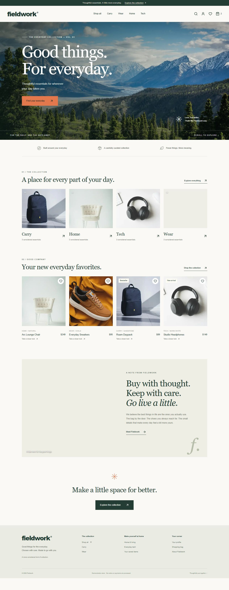
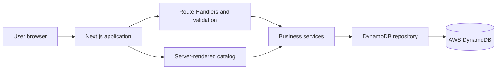

# Fieldwork — good things for the everyday

A full-stack commerce application for the Tynoc Software Engineer Intern assignment. Discover a database-backed catalog, combine search and filters, inspect products, maintain a persistent bag and wishlist, and manage a private guest profile.

**Demonstration store: no orders or payments are processed.** Products, prices, stock, and specifications are sample data. Photographs are illustrative. Profiles use opaque guest sessions rather than registered accounts or email sign-in.



## Features

- Responsive homepage with categories, featured products, and editorial sections.
- Search, category, maximum-price, stock-availability, and sorting filters.
- Product details, stock information, quantity selection, and related products.
- DynamoDB-backed guest profiles, bags, and wishlists that survive page reloads.
- Server-authoritative integer-cent prices, atomic quantity increments, stock limits, and merged duplicate bag lines.
- Idempotent wishlist saves, visitor isolation, profile validation, and explicit data deletion.
- Secure cookies, origin checks, strict input validation, and structured API errors.
- Loading skeletons, empty states, retry interfaces, not-found handling, keyboard labels, and reduced-motion support.
- Unit tests, HTTP/database integration tests, GitHub Actions, and infrastructure documentation.

## Tech stack

| Layer          | Technology                                             |
| -------------- | ------------------------------------------------------ |
| Application    | Next.js 16 App Router, React 19, TypeScript            |
| Styling        | Tailwind CSS 4, responsive CSS, Lucide                 |
| Backend        | Next.js Route Handlers, business services, Zod         |
| Database       | AWS DynamoDB, AWS SDK v3                               |
| Local database | Official AWS DynamoDB Local, Java                      |
| Hosting        | Vercel, with AWS OIDC credential-provider support      |
| Verification   | Node test runner, TypeScript, Prettier, GitHub Actions |

## Installation and local development

Prerequisites: Node.js 24+, npm, Java 17+, and `tar`. Local development requires no AWS account.

```bash
npm ci
cp .env.example .env.local
mkdir -p .data/runtime
curl -L https://s3.us-west-2.amazonaws.com/dynamodb-local/dynamodb_local_latest.tar.gz -o .data/runtime/dynamodb-local.tar.gz
tar -xzf .data/runtime/dynamodb-local.tar.gz -C .data/runtime
npm run db:local
```

PowerShell equivalents: use `Copy-Item .env.example .env.local`, `New-Item -ItemType Directory -Force .data/runtime`, and `Invoke-WebRequest -Uri <the-download-URL-above> -OutFile .data/runtime/dynamodb-local.tar.gz`. If Java is not on PATH, set `JAVA_BIN` to its executable. `DYNAMODB_LOCAL_DIR` can reference another DynamoDB Local installation.

Keep the database running. In another terminal:

```bash
npm run db:setup
npm run db:seed
npm run dev
```

Open **http://127.0.0.1:3001**. The local database listens on **8879** and persists in ignored `.data/dynamo/`. Change `DYNAMODB_LOCAL_PORT` and `DYNAMODB_ENDPOINT` together if necessary.

Setup preserves an existing table. Seeding conditionally creates 12 products and 4 categories, preserving any existing catalog records. Fixtures in `src/data` are used only for provisioning, never as a runtime database fallback.

## Environment variables

| Variable                                                | Purpose                                                                                                                    |
| ------------------------------------------------------- | -------------------------------------------------------------------------------------------------------------------------- |
| `AWS_REGION`                                            | Explicit region containing the table; pin this on Vercel.                                                                  |
| `DYNAMODB_TABLE_NAME`                                   | Application table name.                                                                                                    |
| `DYNAMODB_ENDPOINT`                                     | Local-only endpoint. Omit in AWS production.                                                                               |
| `AWS_ROLE_ARN`                                          | Production role assumed through Vercel OIDC.                                                                               |
| `AWS_ACCESS_KEY_ID`, `AWS_SECRET_ACCESS_KEY`            | Dummy `local` values for local development; otherwise use a restricted AWS identity through the standard credential chain. |
| `AWS_SESSION_TOKEN`                                     | Optional temporary AWS credentials.                                                                                        |
| `JAVA_BIN`, `DYNAMODB_LOCAL_DIR`, `DYNAMODB_LOCAL_PORT` | Local database launcher overrides.                                                                                         |
| `TEST_BASE_URL`                                         | Integration test target; defaults to the local app.                                                                        |

Never expose AWS credentials through `NEXT_PUBLIC_` variables or commit them. Local environment files, runtime downloads, database files, and Vercel metadata are ignored by Git.

## Project structure

```text
src/
  app/                 Pages, layouts, loading/error boundaries, HTTP endpoints
  components/          Reusable UI and browser commerce state
  server/
    db/                DynamoDB client and repository operations
    services/          Catalog filtering, price and stock rules
    http.ts            Response envelope, origin and session checks
    validation.ts      Strict Zod contracts
  types/               Domain interfaces
  lib/                 Presentation utilities
  data/                Catalog provisioning fixtures
scripts/               Database launcher, setup, and seeding
infra/                 CloudFormation reference configuration
tests/                 Unit and HTTP/database integration tests
docs/                  Architecture, API reference, walkthrough, screenshots
public/images/         Product and editorial photographs
```

## Architecture



The catalog uses a sparse secondary index. Private data is queried using a visitor-specific partition. No application operation scans the table. See [architecture and DynamoDB design](docs/ARCHITECTURE.md) for keys, CRUD operations, consistency, and trade-offs.

## AWS DynamoDB setup and deployment

1. Use an activated AWS account and select a region.
2. Review `infra/cloudformation.yaml`. It describes the application table, catalog GSI, TTL, and a Vercel OIDC role restricted to this application's table. The default team/project are `almuzahidseyam` / `fieldwork-commerce`; adapt the trust-policy keys and conditions when reusing it. Set `CreateOidcProvider=false` if the team provider already exists.
3. The reference cloud configuration uses fixed capacity: table **5 RCU / 5 WCU**, index **5 RCU / 5 WCU**, without autoscaling. These are within the published DynamoDB free-tier capacity allowance if other account usage leaves it available. Account eligibility, storage, transfers, and other services can affect costs; this is not a zero-cost guarantee.
4. Seed from an authenticated AWS environment: set `AWS_REGION` and `DYNAMODB_TABLE_NAME`, omit `DYNAMODB_ENDPOINT`, then run `npm run db:seed`.
5. Create a Vercel Next.js project, configure its OIDC issuer mode, and add production `AWS_REGION`, `DYNAMODB_TABLE_NAME`, and `AWS_ROLE_ARN` from the infrastructure outputs. Do not deploy local endpoint or dummy credential variables.
6. Deploy and follow the reviewer walkthrough against the HTTPS URL. Default trust permits only the named production project, not previews.

CloudFormation retains the table if a stack is removed. Review retained resources before cleaning up an environment. The local `db:setup` script creates new tables with on-demand billing; use the reference cloud configuration for fixed-capacity deployment.

## Testing

```bash
npm run typecheck
npm test
npm run build
# With the application and DynamoDB Local running:
npm run test:integration
```

The integration suite creates isolated guest sessions, tests actual HTTP-to-database behavior, and deletes only its own guest data. It covers persistence, ownership, invalid inputs, duplicate records, concurrent stock limits, and profile deletion. CI uses the official AWS DynamoDB Local container.

## Review and screenshots

See the [reviewer walkthrough](docs/REVIEWER_GUIDE.md) and [API reference](docs/API.md).

- [Homepage — desktop](docs/screenshots/home-desktop.jpg)
- [Product listing — desktop](docs/screenshots/shop-desktop.jpg)
- [Product details — desktop](docs/screenshots/product-desktop.jpg)
- [Shopping bag — desktop](docs/screenshots/cart-desktop.jpg)
- [Wishlist — desktop](docs/screenshots/wishlist-desktop.jpg)

## Scope and limitations

The requested catalog, user data, bag, and wishlist workflow is implemented. Checkout, payments, order fulfillment, registered authentication, email verification, and merchant administration are outside scope. Guest profiles are not verified identities. Prices are USD only; variants and inventory reservations are not implemented.

The small catalog is queried before server-side filtering/sorting. A large store would need cursor pagination and dedicated search/index access patterns. Commercial operation also needs distributed rate limiting, monitoring, recovery policies, abuse controls, and fuller authentication.

## Images and development

Images are from Unsplash, stored locally to remove a runtime dependency on its image server. Source identifiers appear in `scripts/download-images.cjs`; the [Unsplash license](https://unsplash.com/license) applies. Descriptions do not imply manufacturer specifications or brand affiliation.

Keep business rules in services, persistence in repositories, and input parsing at the HTTP boundary. Add focused regression tests when commerce rules change. Use `npm run format` before committing.
